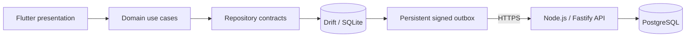

# JCE Management System

**An offline-first point-of-sale and retail management application built with Flutter.**

JCE brings checkout, stock control, purchasing, customer management, and branch administration into one application. Native Windows and Android clients keep local transactions in SQLite and synchronize with the [JCE Backend](https://github.com/estoceorlan-dev/JCE-Backend). The hosted web app supports online checkout and permission-scoped administration.

## What it supports

- **Point of sale:** product lookup, checkout, shifts, payments, receipt workflows, and sale corrections.
- **Retail management:** products, CSV imports, inventory, transfers, purchases and suppliers, customers, loyalty, and reports.
- **Branch administration:** branches, registers, staff, roles, settings, and audit logs.
- **Offline cashier operation:** per-device PIN enrollment, local checkout, durable queued writes, and signed synchronization that retains the original cashier across restarts.
- **Hardware and images:** receipt and scanner integrations, print queues, and optional product images that never block core transactions.

## Architecture



Native business writes and outbox entries commit together locally before synchronization. The API validates permissions and device evidence, applies authoritative transactions, and exposes changes for other clients. Local and hosted installations have distinct deployment identities; pending work never automatically switches databases.

Features follow clean architecture with separate presentation, domain, and data layers. Riverpod provides state and dependency injection, GoRouter handles permission-aware navigation, and shared widgets keep the interface consistent.

| Area | Technology |
| --- | --- |
| UI | Flutter, Material, bundled Poppins fonts |
| State and navigation | Riverpod, GoRouter |
| Local persistence | Drift / SQLite, transactional outbox |
| API and identity | HTTPS, native secure storage, P-256 credentials, offline PIN enrollment |
| Web POS and administration | Same-origin Secure HttpOnly cookies, CSRF protection, online availability gate |
| Tooling | Flutter tests, Drift code generation, GitHub Actions, Vercel build packaging |

## Try the development demo

Use **Flutter 3.44.9 / Dart 3.12.2**, matching CI and the dependency lockfile. Install the desktop or Android platform tooling for your target.

```powershell
flutter pub get --enforce-lockfile
flutter run -d windows --dart-define=JCE_ENV=development --dart-define=JCE_ENABLE_DEMO_AUTH=true --dart-define=JCE_DEMO_BRANCH_ID=demo-main
```

The demo is explicitly enabled for development and runs without a backend. For Android, select a connected device instead of `windows`. Windows development requires plugin symlink support (Developer Mode) and the Visual Studio Desktop development with C++ workload.

## Connect to the API

Provision the [backend](https://github.com/estoceorlan-dev/JCE-Backend) first, then create an ignored local client profile:

```powershell
Copy-Item config/node.local.example.json config/node.local.json
# Fill in the trusted HTTPS API origin, deployment UUID,
# organization code, and public verification keys.
flutter run -d windows --dart-define-from-file=config/node.local.json
```

Client profiles contain public configuration only. Database URLs, passwords, signing private keys, and routing secrets stay outside Flutter builds. Follow the [client deployment guide](docs/deployment.md) for TLS trust, cashier enrollment, hosted web builds, and release checks.

## Development and verification

```powershell
dart format --output=none --set-exit-if-changed lib test integration_test tool
flutter analyze
flutter test
```

For intentional model changes, regenerate code with `dart run build_runner build --delete-conflicting-outputs --low-resources-mode`. Released Drift schema snapshots are immutable; schema changes require a new version and migration. Rebuild `web/drift_worker.js` after a Drift upgrade.

The backend's `npm run test:native-pilot` launches the Windows integration app against a disposable PostgreSQL/API fixture. Set `JCE_FLUTTER_EXECUTABLE` to the pinned Flutter executable first. It tests persistence and replay across app processes; physical hardware acceptance remains separate.

## Repository layout

```text
lib/core/              configuration, routing, storage, sync, shared services
lib/features/          presentation, domain, and data by business feature
lib/shared/            shared models and domain types
assets/                offline data, bundled fonts, and image assets
config/                public client profile examples
test/                  unit, widget, repository, and contract tests
integration_test/      native process-restart scenarios
tool/                  configuration validation, code and deployment tooling
docs/                  architecture and deployment documentation
```

## Documentation

- [Frontend architecture](docs/architecture.md)
- [Client deployment and environment configuration](docs/deployment.md)
- [Public release profiles](config/README.md)
- [Windows production transport decision](docs/adr/0001_windows_production_transport.md)
- [Backend architecture and deployment](https://github.com/estoceorlan-dev/JCE-Backend#documentation)

## Project status

Windows and Android are the native POS targets. Authorized cashiers can use checkout in a browser and claim a register for that browser profile. The current hosted web profile requires API availability. Windows production startup remains blocked until the [transport acceptance requirements](docs/adr/0001_windows_production_transport.md) are met. Hosted staging, recovery, signed installers, and physical till, scanner, printer, and cash-drawer checks remain release acceptance work. Linux, macOS, and iOS scaffolds are retained for evaluation.
